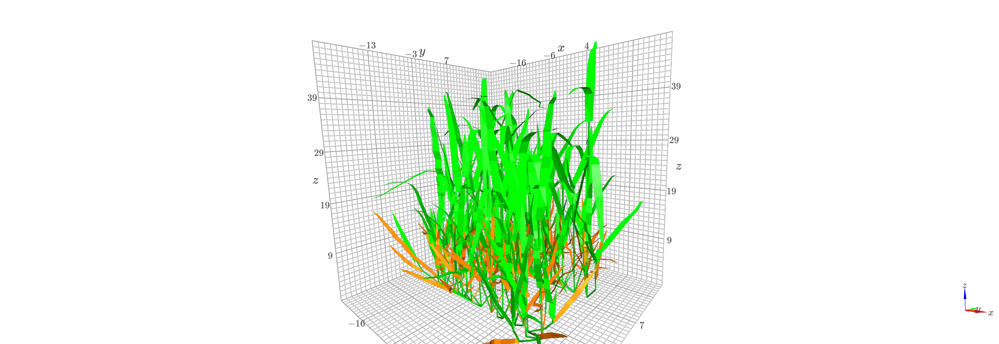

.. Do not edit this file. Edit user/overview.txt, user/index user/autosum 
.. You may add as many files as you want in ./user.

.. _adel:

.. module:: adel

Welcome to Openalea Adel's documentation
########################################

OpenAlea.Adel (Architectural model of DEvelopment based on L-systems)
allows to simulate the 3D architectural development of the shoot of
gramineaous plant.
The package hosts generic data structure and simulation tools for
gramineaous plants (Fournier & Pradal, unpublished), the Adel-Maize
[fournier1999]_, Adel-Wheat [fournier2003]_ models,
together with the wheat parameterization model of [abichou2013]_
and the plastic leaf model of [fournier2012]_.

Getting started
===============

Grow a wheat plant for 80 days at 15 °C with the default parameters (Adel's sample plant), and look at it:

.. code-block:: python

    from openalea.adel.simulation import simulate

    result = simulate(days=80)
    print(result.summary)                         # per day: thermal time, Haun stage, tillers, height, leaf area
    result.draw()                                 # the plant in 3D
    result = simulate({"phyllochron": 100.}, days=80)

User guide
==========

For newcomers to Adel, to plant models or to Python modelling: grow a plant, change its parameters, explore them,
use experimental data, couple it with a light model. Each tutorial is a notebook in ``example/tutorials/user/``,
shown here with its results.

.. toctree::
    :maxdepth: 1

    ./installation.rst
    tutorials/user/01_first_run
    tutorials/user/02_change_a_parameter
    tutorials/user/03_combine_parameters
    tutorials/user/04_sensitivity_analysis
    tutorials/user/05_experimental_data
    tutorials/user/06_with_other_models
    The parameters in plain words<parameters.rst>

Developer guide
===============

For those who read, check, change or couple the model: how ``ShootArchitecture`` is written as a metafspm component,
how it was ported from the original Adel and validated, its equations and its performance. Best read after the first
user tutorial.

.. toctree::
    :maxdepth: 1

    tutorials/developer/00_overview
    tutorials/developer/01_shoot_architecture_in_metafspm
    tutorials/developer/02_extend_the_component
    ShootArchitecture, the metafspm port<port/index.rst>
    Reference Guide<user/autosum.rst>

The original Adel
=================

The original package's documentation: Adel-Maize and Adel-Wheat, with their R kinetics (``openalea.adel.legacy``).

.. toctree::
    :maxdepth: 1

    User Guide<user/index.rst>
    The original Adel's notebook<example/notebook.rst>
    ./references.rst

- A `PDF <../latex/adel.pdf>`_ version of |adel| documentation is 
  available.

.. seealso::

   More documentation can be found on the
   `openalea <http://openalea.gforge.inria.fr/dokuwiki/doku.php?id=packages:openalea:adel:adel>`__ wiki.

Authors
=======

.. include:: ../AUTHORS.txt

ChangeLog
=========

.. include:: ../CHANGELOG.md
   :parser: myst_parser.sphinx_

License
=======

|adel| is released under a Cecill-C License.

.. note:: `Cecill-C <http://www.cecill.info/licences/Licence_CeCILL-C_V1-en.html>`_ 
    license is a LGPL compatible license.

.. |adel| replace:: OpenAlea.Adel
